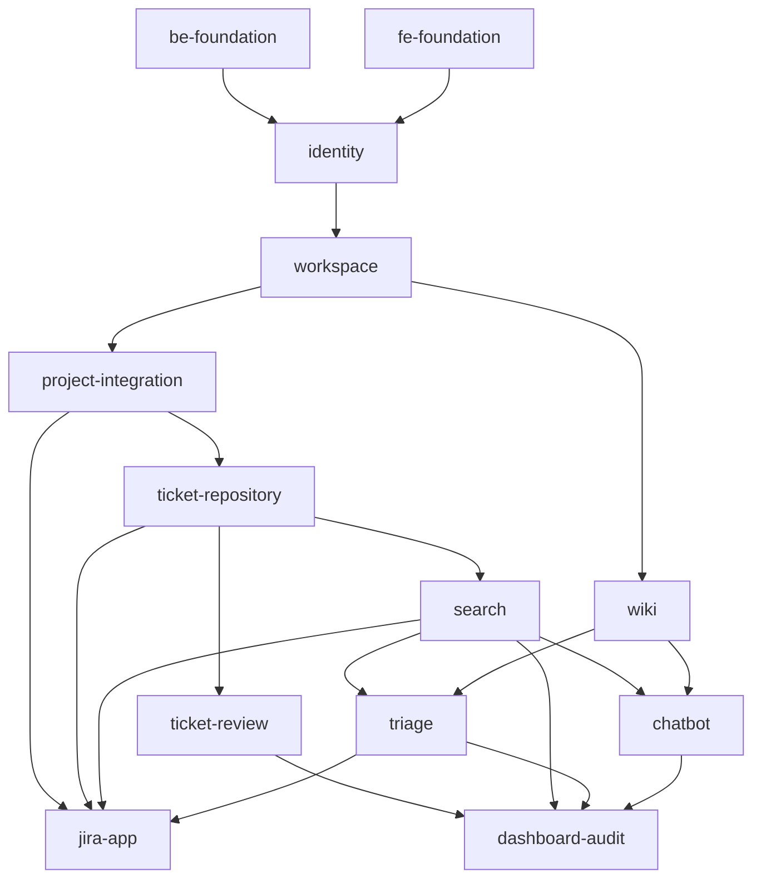

# Module Map

## Overview
Full-stack modules (backend + web app) cut along the 13 Report3 features, two foundations that every feature
builds on, and the Jira App. Small features are merged (Wiki Space + Wiki Document; Intelligent Retrieval +
Reuse & Feedback; Dashboard + Audit). Each module has an owner who plans and builds it; the Team Lead approves
its spec. Owners can change: edit the Owner column and the module's `module.md`.

## Modules

| Module | Report3 feature · UCs | Owner | Complexity | Repos | Dependencies |
|--------|-----------------------|-------|-----------|-------|--------------|
| `be-foundation` | Five roles in security, `/me`, `ProblemDetail` + MSG codes, audit events | Anh Tran Hai | medium | default | — |
| `fe-foundation` | Web app base: roles, session, guards, landing, menus, routes, catalog, mocks, guidelines (KAN-57) | Trần Trung Hiếu | large | default | — |
| `identity` | Role-Based Access Control · UC-01–09 | Trần Trung Hiếu (UC-01–03) · Đặng Tấn Bình (UC-04–09) · Phạm Tùng Dương (RBAC rules) | large | default | be-foundation, fe-foundation |
| `workspace` | Workspace & Department Management · UC-10–15 | Đặng Tấn Bình | medium | default | identity |
| `project-integration` | Ticket tracker integration · UC-16–18 | Đặng Tấn Bình | medium | default | workspace |
| `wiki` | Wiki Space + Wiki Document Management · UC-38–50 | Đặng Nhật Minh | large | default | workspace |
| `ticket-repository` | Ticket Import & Repository · UC-20–25 | Đặng Nhật Minh | large | default | project-integration |
| `search` | Intelligent Retrieval + Reuse & Feedback · UC-26–28 | Trần Hải Anh | large | default | ticket-repository |
| `ticket-review` | Review & Approval Workflow · UC-29–33 | Phạm Tùng Dương | large | default | ticket-repository |
| `triage` | AI Ticket Triage · UC-36–37 | Trần Hải Anh | medium | default | search, wiki |
| `chatbot` | Knowledge Chatbot · UC-51–53 | Trần Trung Hiếu | medium | default | search, wiki |
| `jira-app` | The Forge app: Solution Form (UC-19), Issue Panel, triage comment | Đặng Tấn Bình | large | default | project-integration, ticket-repository, search, triage |
| `dashboard-audit` | Dashboard & Audit · UC-34–35 | Trần Hải Anh (UC-34) · Đặng Nhật Minh (UC-35) | medium | default | ticket-review, search, triage, chatbot |

`ticket-review` comes with PR #26 (KAN-24): its `module.md`, spec and status join this map when that PR merges,
with the paths below.

## Dependency Graph

An arrow means "is used by". The graph has no cycles. A module can be built before its dependencies are done,
against a mocked interface (MSW mocks in the web app, a port with a test double in the backend).

## Implementation Order
1. `be-foundation`, `fe-foundation` — roles, session, errors and the shared bases every module uses.
2. `identity` — users and their roles need the foundations.
3. `workspace` — the company information and Departments.
4. `project-integration`, `wiki` — Projects and Spaces belong to a Department.
5. `ticket-repository` — tickets belong to Projects.
6. `search`, `ticket-review` — both work on the repository's tickets.
7. `triage`, `chatbot`, `jira-app` — they use Search's retrieval and the Wiki; the Jira App also uses Projects and tickets.
8. `dashboard-audit` — it reports on review, search, triage and the chatbot.

## Paths

Each module owns its code and tests (`paths` in its `module.md`). **Test paths never overlap**, so
`sdd.ts trace` credits every test to one module. Shared contract files are not tests; every module that changes
them lists them:

- `frontend/openapi/**`, `frontend/src/shared/api/generated/**` — the API contract (owner: `fe-foundation`).
- `backend/src/main/resources/db/changelog/**` — Liquibase changesets (owner: `be-foundation`).
- `docs/bug-log.md` — every module.

Backend packages follow `backend/AGENTS.md` §1 (one package per module under `vn/tsolve/`). Packages that do
not exist yet are marked *proposed*; the backend lead confirms them when the module is planned.

| Module | Backend | Web app |
|--------|---------|---------|
| `be-foundation` | `common/**`, `TSolveApplication.java`, `resources/application*.yml`; also `backend/pom.xml`, `backend/AGENTS.md` and the imports of `knowledge/Solution.java`, `knowledge/SolutionService.java`, `ticket/TicketService.java` (planned 23/10) | — |
| `fe-foundation` | — | `src/app/**`, `src/shared/**`, `src/mocks/**`, `src/test/**`, `features/*/routes.ts`, `features/*/index.ts`, `features/*/mocks/handlers.ts`, root config files, `AGENTS.md`, `guidelines/**` |
| `identity` | `identity/**` | `features/auth/**`, `features/my-profile/**`, `features/users/**` |
| `workspace` | `workspace/**` | `features/workspace/**` |
| `project-integration` | `project/**` *(proposed)* | `features/jira-integration/**` |
| `wiki` | `wiki/**` *(proposed)* | `features/wiki/**` |
| `ticket-repository` | `ticket/**`, `knowledge/**` | `features/ticket-import/**`, `features/tickets/**` |
| `search` | `search/**` (feedback included) | `features/search/**`, `features/feedback/**` |
| `ticket-review` | `review/**` *(proposed; PR #26 moves its classes there)* | `features/review/**` |
| `triage` | `triage/**` *(proposed)* | `features/triage/**` |
| `chatbot` | `chatbot/**` *(proposed)* | `features/chatbot/**` |
| `jira-app` | — | `jira-app/**` (the Forge app) |
| `dashboard-audit` | `analytics/**` | `features/knowledge-dashboard/**`, `features/audit-log/**` |

Backend paths are under `backend/src/main/java/vn/tsolve/` and `backend/src/test/java/vn/tsolve/`; web app paths
under `frontend/`. Until `triage`, `wiki` and `chatbot` are planned, `fe-foundation` also owns their placeholder
folders, and until `ticket-review` is on `main` it also owns `features/review/**`; each module's planning (or
arrival) removes its folder from `fe-foundation`.

## Cross-module interface contracts
- **Session and roles** (`be-foundation` → all): `GET /api/v1/me` with all roles, Department, Departments,
  Projects and managed Spaces; `@PreAuthorize` role constants; `ProblemDetail` errors with a Report3 `code`.
- **Retrieval** (`search` → `triage`, `chatbot`, `jira-app`): one search interface over Published tickets and
  Wiki documents, filtered by what the user may see (agreed between Trần Hải Anh and Trần Trung Hiếu, KAN-38).
- **Tickets** (`ticket-repository` → `search`, `ticket-review`, `jira-app`): ticket and Solution records; the
  Solution Form submission endpoint used by the Jira App.
- **Projects and Spaces** (`project-integration`, `wiki` → others): Project membership and roles; Space access.
- **Web app base** (`fe-foundation` → every screen): routes, guards, menus, kit components, MSG catalog, mocks.
