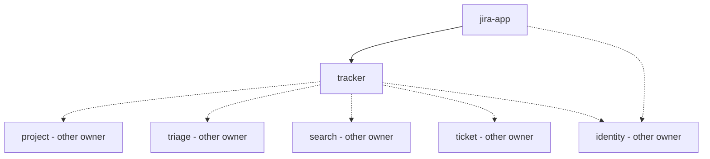

# Module Map

## Overview
Decomposition of the Jira integration (context brief, 2026-10-21). Two modules, both owned by the same
developer: `tracker` (server side, package `vn.tsolve.tracker`) and `jira-app` (Forge app). The other server
packages from the architecture diagram (`project`, `triage`, `search`, `ticket`, `knowledge`/review, `ai`,
`identity`) belong to other members and are not decomposed here; they appear as external dependencies and
are stubbed until available.

## Modules

| Module | Complexity | Repos | Dependencies |
|--------|-----------|-------|--------------|
| tracker | medium | monorepo `backend/` (+ OpenAPI contract) | — (external: project, triage, search, ticket, identity, Jira) |
| jira-app | medium | monorepo `jira-app/` | tracker (external: Jira, identity) |

## Dependency Graph

## Implementation Order
1. **Contract** — add the Jira App API paths to `frontend/openapi/tsolve-api.yaml` (part of tracker's first feature)
2. **tracker** — the API and FIT verification must exist before the Jira App can call anything
3. **jira-app** — triggers and panel against the running tracker API

Work in vertical slices across both modules: (1) ticket created → event accepted on the server,
(2) triage comment + panel suggestions, (3) Done → AI draft → Solution Form → Review Queue.

## Cross-Module Interface Contracts
| From → To | Contract | Auth |
|-----------|----------|------|
| jira-app → tracker | Jira App API, REST JSON in `frontend/openapi/tsolve-api.yaml` | Forge Invocation Token |
| tracker → Jira | Jira REST API v3 | Forge app system token |
| tracker → other packages | Java service interfaces | in-process |
