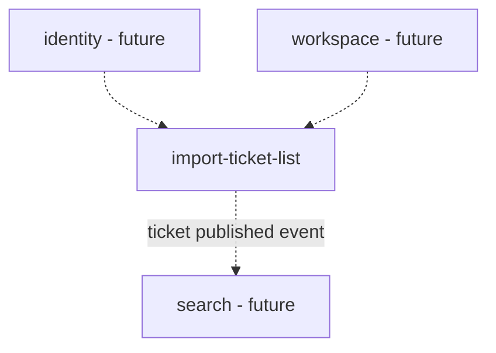

# Module Map

## Overview
Decomposition is incremental, one epic at a time (decided 2026-10-21). Only the Ticket Import & Repository epic (KAN-29) is decomposed so far. identity, workspace and search are named as future dependencies; they are added here when their epics start.

## Modules

| Module | Complexity | Repos | Dependencies |
|--------|-----------|-------|--------------|
| import-ticket-list | large | default | — (identity and workspace are stubbed until they are decomposed) |

## Dependency Graph

## Implementation Order
1. import-ticket-list — the only module so far. Its first feature is KAN-31 CSV import.

## Cross-Module Contracts
- import-ticket-list consumes the current user and role (identity), and the managed Projects, Project status and Jira token (workspace). It reaches them through service interfaces that are stubbed for now.
- import-ticket-list publishes a "ticket published" event after commit, for search indexing.
