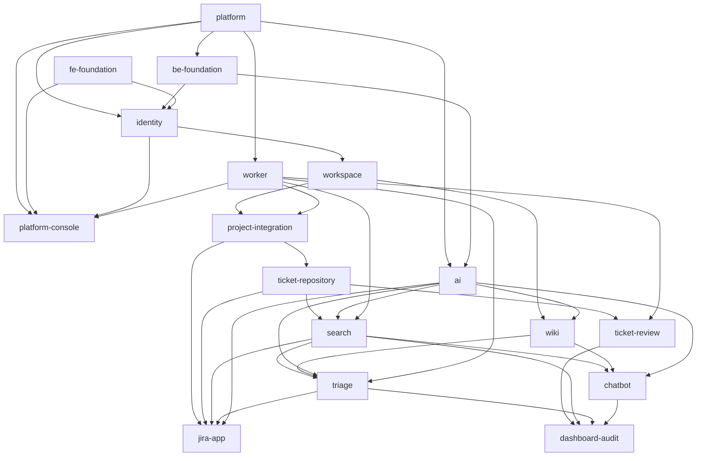

# Module Map

## Overview
Full-stack modules (backend + web app) cut along the 13 Report3 features, two foundations that every feature
builds on, the Jira App, and four platform modules of the multi-tenant pool model (ADR-0001, GBR-37): the tenant
layer and infrastructure (`platform`), the Platform Console (`platform-console`), background jobs and email
(`worker`) and the AI gateway (`ai`). Small features are merged (Wiki Space + Wiki Document; Intelligent Retrieval +
Reuse & Feedback; Dashboard + Audit). Each module has an owner who plans and builds it; the Team Lead approves
its spec. Owners are the Jira assignees of the module's Stories (D40); a Story's assignee may differ from the module
owner (see "Stories → module"). Owners can change: edit the Owner column and the module's `module.md`.

## Modules

| Module | Report3 feature · UCs | Owner | Complexity | Repos | Dependencies |
|--------|-----------------------|-------|-----------|-------|--------------|
| `platform` | Tenant layer: `TenantContext`, base entity with `workspace_id`, RLS, Tenant Resolvers (host, `cloudId`), Forge Invocation Token check, Workspace registry, file storage per Workspace; infrastructure (Compose, Caddy, CI/CD, VPS, seed) | Trần Trung Hiếu | large | default | — |
| `be-foundation` | Five roles in security, `/me`, `ProblemDetail` + MSG codes, audit events | Anh Tran Hai | medium | default | platform |
| `fe-foundation` | Web app base: roles, session, guards, landing, menus, routes, catalog, mocks, guidelines (KAN-57) | Trần Trung Hiếu | large | default | — |
| `ai` | AI gateway: chat LLM and bge-m3 embedding clients (Ollama on the AI VPS), PII masking, AI draft and rewrite of a Solution (UC-19), model benchmark | Trần Hải Anh | medium | default | platform, be-foundation |
| `worker` | Background worker: JobRunr OSS jobs per Workspace, `runInTenant`, Suspended Workspaces postponed, per-Workspace cap; SMTP email | Phạm Tùng Dương | medium | default | platform |
| `identity` | Role-Based Access Control · UC-01–09 | Trần Trung Hiếu (UC-01–03) · Phạm Tùng Dương (UC-04–09, RBAC rules) | large | default | platform, be-foundation, fe-foundation |
| `platform-console` | Platform Operator · UC-54–56 (P-01…03) | Đặng Tấn Bình | medium | default | platform, identity, worker, fe-foundation |
| `workspace` | Workspace & Department Management · UC-10–15 | Đặng Tấn Bình | medium | default | identity |
| `project-integration` | Ticket tracker integration · UC-16–18; tracker client and issue events | Đặng Tấn Bình | medium | default | workspace, worker |
| `wiki` | Space Management + Wiki Document Management · UC-38–50 | Đặng Nhật Minh | large | default | workspace, ai |
| `ticket-repository` | Ticket Import & Repository · UC-20–25 | Đặng Nhật Minh | large | default | project-integration |
| `search` | Intelligent Retrieval + Reuse & Feedback · UC-26–28; embedding pipeline of tickets | Trần Hải Anh | large | default | ticket-repository, ai, worker |
| `ticket-review` | Review & Approval Workflow · UC-29–33 | Phạm Tùng Dương | large | default | ticket-repository, worker |
| `triage` | AI Ticket Triage · UC-36–37 | Trần Hải Anh | medium | default | search, wiki, ai, worker |
| `chatbot` | Knowledge Chatbot · UC-51–53 | Trần Trung Hiếu (web app, done) · Trần Hải Anh (backend) | medium | default | search, wiki, ai |
| `jira-app` | The Forge app: Solution Form (UC-19), Issue Panel, triage comment, sign-in link, install on several Jira sites | Đặng Tấn Bình | large | default | project-integration, ticket-repository, search, triage, ai |
| `dashboard-audit` | Dashboard & Audit · UC-34–35 | Trần Hải Anh (UC-34) · Phạm Tùng Dương (UC-35) | medium | default | ticket-review, search, triage, chatbot |

`ticket-review` comes with PR #26 (KAN-24): its `module.md`, spec and status join this map when that PR merges,
with the paths below; its `module.md` then also lists `worker` (JOB-02, emails).

## Dependency Graph

An arrow means "is used by". The graph has no cycles. A module can be built before its dependencies are done,
against a mocked interface (MSW mocks in the web app, a port with a test double in the backend). A module that must
tell a module above it about a change publishes an application event (for example `ticket-repository` → `search`
when a ticket is Published or Unpublished), so no arrow points down. Every module uses `common/` (its base
exceptions, roles, `TenantContext`); that is not a module dependency (`backend/AGENTS.md` §1).

## Implementation Order
1. `platform` — the tenant layer and the infrastructure every request, job and file depends on.
2. `be-foundation`, `fe-foundation`, `worker`, `ai` — roles, session, errors, jobs and the AI clients on top of the tenant layer.
3. `identity` — users and their roles need the foundations and the Workspace of the request.
4. `platform-console`, `workspace` — Workspaces are created and their first Admin invited; then the company information and Departments.
5. `project-integration`, `wiki` — Projects and Spaces belong to a Department.
6. `ticket-repository` — tickets belong to Projects.
7. `search`, `ticket-review` — both work on the repository's tickets.
8. `triage`, `chatbot`, `jira-app` — they use Search's retrieval and the Wiki; the Jira App also uses Projects and tickets.
9. `dashboard-audit` — it reports on review, search, triage and the chatbot.

## Paths

Each module owns its code and tests (`paths` in its `module.md`). **Test paths never overlap**, so
`sdd.ts trace` credits every test to one module. Shared contract files are not tests; every module that changes
them lists them:

- `frontend/openapi/**`, `frontend/src/shared/api/generated/**` — the API contract (owner: `fe-foundation`).
- `backend/src/main/resources/db/changelog/**` — Liquibase changesets (owner: `be-foundation`).
- `frontend/Dockerfile`, `frontend/Caddyfile` — the web app image (owner: `fe-foundation`; `platform` lists them for deployment).
- `docs/bug-log.md` — every module.

Backend packages follow `backend/AGENTS.md` §1 (one package per module under `vn/tsolve/`). Packages that do
not exist yet are marked *proposed*; the backend lead confirms them when the module is planned.

| Module | Backend | Web app | Other |
|--------|---------|---------|-------|
| `platform` | `platform/**` *(proposed)*, `common/tenant/**` *(proposed)* | — | `docker-compose*.yml`, `infra/**` *(proposed: Caddy, deploy, AI VPS, `infra/seed/`)*, `.github/workflows/**`, `.env.example`, `backend/Dockerfile` *(proposed)* |
| `be-foundation` | `common/**` except `common/tenant/**` (its folders: `config`, `error`, `exception`, `security`, `session`, `audit`, `util`), `TSolveApplication.java`, `resources/application*.yml`; also `backend/pom.xml`, `backend/AGENTS.md` and the imports of `knowledge/Solution.java`, `knowledge/SolutionService.java`, `ticket/TicketService.java` (planned 23/10) | — | — |
| `fe-foundation` | — | `src/app/**`, `src/shared/**`, `src/mocks/**`, `src/test/**`, `features/*/routes.ts`, `features/*/index.ts`, `features/*/mocks/handlers.ts`, root config files, `AGENTS.md`, `guidelines/**` | — |
| `ai` | `ai/**` *(proposed)* | — | — |
| `worker` | `worker/**` *(proposed; SMTP in `worker/client/`)* | — | — |
| `identity` | `identity/**` | `features/auth/**`, `features/my-profile/**`, `features/users/**` | — |
| `platform-console` | `console/**` *(proposed)* | `features/platform-console/**` *(proposed)* | — |
| `workspace` | `workspace/**` | `features/workspace/**` | — |
| `project-integration` | `project/**` *(proposed)* | `features/jira-integration/**` | — |
| `wiki` | `wiki/**` *(proposed)* | `features/wiki/**` | — |
| `ticket-repository` | `ticket/**`, `knowledge/**` | `features/ticket-import/**`, `features/tickets/**` | — |
| `search` | `search/**` (feedback and the embedding pipeline included) | `features/search/**`, `features/feedback/**` | — |
| `ticket-review` | `review/**` *(proposed; PR #26 moves its classes there)* | `features/review/**` | — |
| `triage` | `triage/**` *(proposed)* | `features/triage/**` | — |
| `chatbot` | `chatbot/**` *(proposed)* | `features/chatbot/**` | — |
| `jira-app` | — | `jira-app/**` (the Forge app) | — |
| `dashboard-audit` | `analytics/**` | `features/knowledge-dashboard/**`, `features/audit-log/**` | — |

Backend paths are under `backend/src/main/java/vn/tsolve/` and `backend/src/test/java/vn/tsolve/`; web app paths
under `frontend/`; "Other" paths from the repo root. Until `triage` and `wiki` are planned, `fe-foundation` also owns their placeholder
folders (`chatbot` took its folder with its plan, KAN-69), and until `ticket-review` is on `main` it also owns
`features/review/**`; each module's planning (or arrival) removes its folder from `fe-foundation`.

## Cross-module interface contracts
- **TenantContext and Tenant Resolver** (`platform` → all): `TenantContext` in `common/tenant/` holds the
  Workspace of the current request or job (read it; require it, failing when there is none); it is set only by the
  resolvers — host name of a Workspace site (MSG119), verified `cloudId` of the Forge Invocation Token (MSG124),
  signed state value on `login.` (D9) — or by `runInTenant` for a job, never from request data (GBR-37). The base
  entity carries `workspace_id` as `@TenantId`; RLS reads the same Workspace. A Suspended Workspace is refused
  (MSG120, MSG121).
- **Workspace registry** (`platform` → `platform-console`, `identity`, `jira-app`, `worker`): find a Workspace by site
  name or Jira `cloudId`, its status and Google domain; create a Workspace with its Jira site URLs, suspend and
  reactivate it (called by `platform-console`); bind a Jira site's `cloudId` from the verified install event
  (called by `jira-app`, GBR-14).
- **File storage** (`platform` → `wiki`, `ticket-repository`, `jira-app`): upload, read and delete a file under
  `/{workspaceId}/…` of the current Workspace; path traversal refused; size limit.
- **Job queue and `runInTenant`** (`worker` → `platform-console`, `project-integration`, `search`, `ticket-review`,
  `triage`): enqueue a job (it takes the `workspaceId` from `TenantContext`), schedule a recurring job per
  Workspace (JOB-02 at 00:00); every job runs inside `runInTenant(workspaceId, …)`; a Suspended Workspace's job is
  postponed (D12); at most a configured number of one Workspace's jobs run at once (D43). Email: send a mail through
  SMTP as a job.
- **LLM and embedding clients, PII masking** (`ai` → `search`, `wiki`, `triage`, `chatbot`, `jira-app`): `LlmClient`
  (chat completion) and `EmbeddingClient` (bge-m3, 1024 dimensions) on Ollama at `OLLAMA_BASE_URL`; the PII masking
  service that every caller applies before text goes to a model (GBR-12); an AI failure is reported, never thrown
  past the caller's fallback (GBR-12). REST: AI draft and AI rewrite of a Solution (UC-19), used by the Solution Form.
- **Session and roles** (`be-foundation` → all): `GET /api/v1/me` with all roles, Department, Departments,
  Projects and managed Spaces; `@PreAuthorize` role constants; `ProblemDetail` errors with a Report3 `code`.
- **Retrieval** (`search` → `triage`, `chatbot`, `jira-app`): one search interface over Published tickets and
  Wiki documents of the current Workspace, filtered by what the user may see (agreed between Trần Hải Anh and Trần
  Trung Hiếu, KAN-38).
- **Tickets** (`ticket-repository` → `search`, `ticket-review`, `jira-app`): ticket and Solution records; the
  Solution Form submission endpoint used by the Jira App; events when a ticket is Published or Unpublished.
- **Projects and Spaces** (`project-integration`, `wiki` → others): Project membership and roles; Space access.
- **Web app base** (`fe-foundation` → every screen): routes, guards, menus, kit components, MSG catalog, mocks; the
  route tree chosen by host (Workspace site or `admin.`).

## Stories → module

Every Story and Task of Jira KAN-94…203 (export of 25/10, checked in Jira), mapped to exactly one module.
Assignee = the Jira assignee (D40).

| Jira | Assignee | Summary | Module |
|------|----------|---------|--------|
| KAN-94 | Trần Trung Hiếu | Docker Compose: pgvector, Ollama, worker | `platform` |
| KAN-95 | Trần Trung Hiếu | Caddy wildcard and routing by host name | `platform` |
| KAN-96 | Đặng Nhật Minh | File storage per Workspace | `platform` |
| KAN-97 | Trần Trung Hiếu | Seed demo data of 2 Workspaces (dev and staging only, D42) | `platform` |
| KAN-98 | Trần Trung Hiếu | Liquibase base + base entity with `workspace_id` | `platform` |
| KAN-99 | Trần Trung Hiếu | Tenant Resolver + TenantContext for the web app | `platform` |
| KAN-100 | Trần Hải Anh | PostgreSQL row-level security | `platform` |
| KAN-101 | Trần Trung Hiếu | Tenant Resolver for the Jira App (`cloudId` → Workspace) | `platform` |
| KAN-102 | Phạm Tùng Dương | Run jobs in the right TenantContext (`runInTenant`) | `worker` |
| KAN-103 | Trần Trung Hiếu | [UC-01] Sign in through the central sign-in (Google OIDC) | `identity` |
| KAN-104 | Trần Trung Hiếu | [UC-01] Session per site and landing page per role | `identity` |
| KAN-105 | Trần Trung Hiếu | Verify the Forge Invocation Token | `platform` |
| KAN-106 | Trần Trung Hiếu | [UC-02] Log out | `identity` |
| KAN-107 | Phạm Tùng Dương | [UC-04] View the Accounts of the Workspace | `identity` |
| KAN-108 | Phạm Tùng Dương | [UC-05] Add Account | `identity` |
| KAN-109 | Phạm Tùng Dương | [UC-06] Update Account status | `identity` |
| KAN-110 | Phạm Tùng Dương | [UC-07] Update roles and Department | `identity` |
| KAN-111 | Phạm Tùng Dương | [UC-08] Hand over Projects | `identity` |
| KAN-112 | Phạm Tùng Dương | [UC-09] Hand over Spaces | `identity` |
| KAN-113 | Đặng Tấn Bình | [UC-54] View Workspaces (Platform Console) | `platform-console` |
| KAN-114 | Đặng Tấn Bình | [UC-55] Create Workspace | `platform-console` |
| KAN-115 | Đặng Tấn Bình | [UC-55] Suspend / reactivate a Workspace | `platform-console` |
| KAN-116 | Đặng Tấn Bình | [UC-56] Invite the first Admin | `platform-console` |
| KAN-117 | Phạm Tùng Dương | Role union + method security | `identity` |
| KAN-118 | Phạm Tùng Dương | Department / Project / Space scope checks | `identity` |
| KAN-119 | Đặng Tấn Bình | [UC-10, UC-11] Add / update Workspace information | `workspace` |
| KAN-120 | Đặng Tấn Bình | [UC-12] Create Department | `workspace` |
| KAN-121 | Đặng Tấn Bình | [UC-13] Update Department | `workspace` |
| KAN-122 | Đặng Tấn Bình | [UC-14] Delete Department | `workspace` |
| KAN-123 | Đặng Tấn Bình | [UC-15] Restore Department | `workspace` |
| KAN-124 | Đặng Tấn Bình | Forge Remote, sign-in link, install on several Jira sites | `jira-app` |
| KAN-125 | Đặng Tấn Bình | TicketTrackerClient + JiraClient | `project-integration` |
| KAN-126 | Đặng Tấn Bình | Receive the issue created event to run triage | `project-integration` |
| KAN-127 | Đặng Tấn Bình | [UC-16] Add a Project linked to a Jira project | `project-integration` |
| KAN-128 | Đặng Tấn Bình | [UC-17] Add a Ticket Resolver to a Project | `project-integration` |
| KAN-129 | Đặng Tấn Bình | [UC-18] Remove a member from a Project | `project-integration` |
| KAN-130 | Đặng Tấn Bình | [UC-19] Resubmit after a change request | `jira-app` |
| KAN-131 | Đặng Tấn Bình | [UC-36] Post the triage comment and record the answer | `jira-app` |
| KAN-132 | Đặng Nhật Minh | Ticket status model | `ticket-repository` |
| KAN-133 | Đặng Nhật Minh | [UC-22] Create a ticket with its Solution by hand | `ticket-repository` |
| KAN-134 | Đặng Nhật Minh | [UC-23] View import history | `ticket-repository` |
| KAN-135 | Đặng Nhật Minh | [UC-24] View ticket details | `ticket-repository` |
| KAN-136 | Đặng Nhật Minh | [UC-25] Unpublish / re-publish a ticket | `ticket-repository` |
| KAN-137 | Đặng Nhật Minh | Unify the ticket model in code | `ticket-repository` |
| KAN-138 | Trần Hải Anh | PII masking | `ai` |
| KAN-139 | Trần Hải Anh | LLM client + embedding client (Ollama) | `ai` |
| KAN-140 | Đặng Nhật Minh | Benchmark of the AI models on CPU | `ai` |
| KAN-141 | Trần Hải Anh | Embedding pipeline for tickets | `search` |
| KAN-142 | Trần Hải Anh | [UC-19] AI draft Solution API | `ai` |
| KAN-143 | Trần Hải Anh | [UC-19] AI rewrite Solution API | `ai` |
| KAN-144 | Trần Hải Anh | [UC-26] Search API of the web app | `search` |
| KAN-145 | Trần Hải Anh | [UC-26] Search page of the web app | `search` |
| KAN-146 | Trần Hải Anh | [UC-26] Suggestions API for the Issue Panel | `search` |
| KAN-147 | Trần Hải Anh | [UC-27] Ticket list with filters | `search` |
| KAN-148 | Trần Hải Anh | [UC-28] Feedback on a ticket | `search` |
| KAN-149 | Trần Hải Anh | [UC-37] View triage history | `triage` |
| KAN-150 | Trần Hải Anh | [UC-34] Knowledge dashboard figures API | `dashboard-audit` |
| KAN-151 | Trần Hải Anh | [UC-34] Dashboard page | `dashboard-audit` |
| KAN-152 | Phạm Tùng Dương | [UC-35] Record the audit log (on `be-foundation`'s audit writer) | `dashboard-audit` |
| KAN-153 | Phạm Tùng Dương | [UC-35] View and filter the audit log | `dashboard-audit` |
| KAN-154 | Phạm Tùng Dương | [UC-29] Review Queue updated in real time | `ticket-review` |
| KAN-155 | Phạm Tùng Dương | [UC-30] Email to the writer on Reject / Request changes | `ticket-review` |
| KAN-156 | Phạm Tùng Dương | [UC-30] Return an Expired ticket to the Review Queue | `ticket-review` |
| KAN-157 | Phạm Tùng Dương | [UC-33] JOB-02 marks overdue tickets | `ticket-review` |
| KAN-158 | Phạm Tùng Dương | [UC-31] View Expired tickets | `ticket-review` |
| KAN-159 | Phạm Tùng Dương | [UC-32] View review history | `ticket-review` |
| KAN-160 | Trần Trung Hiếu | [UC-03] View my profile | `identity` |
| KAN-161 | Phạm Tùng Dương | Background worker skeleton | `worker` |
| KAN-162 | Phạm Tùng Dương | Send email through SMTP | `worker` |
| KAN-163 | Đặng Nhật Minh | [UC-38] View Space permissions | `wiki` |
| KAN-164 | Đặng Nhật Minh | [UC-39] Grant Space access | `wiki` |
| KAN-165 | Đặng Nhật Minh | [UC-40] Revoke Space access | `wiki` |
| KAN-166 | Đặng Nhật Minh | [UC-41] Create folder | `wiki` |
| KAN-167 | Đặng Nhật Minh | [UC-48] Upload several documents | `wiki` |
| KAN-168 | Đặng Nhật Minh | [UC-48] Extract text and preview | `wiki` |
| KAN-169 | Đặng Nhật Minh | [UC-48] Publish documents and their embeddings | `wiki` |
| KAN-170 | Đặng Nhật Minh | [UC-49] View and find Wiki documents | `wiki` |
| KAN-171 | Đặng Nhật Minh | [UC-44] Browse the folder tree | `wiki` |
| KAN-172 | Đặng Nhật Minh | [UC-43] Delete an empty folder | `wiki` |
| KAN-173 | Đặng Nhật Minh | [UC-50] Delete a Wiki document | `wiki` |
| KAN-174 | Đặng Nhật Minh | [UC-42] Rename / move a folder | `wiki` |
| KAN-175 | Đặng Nhật Minh | [UC-45] View the Space's trash | `wiki` |
| KAN-176 | Đặng Nhật Minh | [UC-46] Restore a deleted document | `wiki` |
| KAN-177 | Đặng Nhật Minh | [UC-47] Delete a document permanently | `wiki` |
| KAN-178 | Trần Hải Anh | Take over the chatbot code from Hiếu | `chatbot` |
| KAN-179 | Trần Hải Anh | [UC-51] Answer from the Solutions and Wiki documents the user may see | `chatbot` |
| KAN-180 | Trần Hải Anh | [UC-51] Cite the sources | `chatbot` |
| KAN-181 | Trần Hải Anh | [UC-51] Follow-up questions in the session's context | `chatbot` |
| KAN-182 | Trần Hải Anh | [UC-53] Rate a Chatbot answer | `chatbot` |
| KAN-183 | Trần Hải Anh | [UC-52] View the chat history of the session | `chatbot` |
| KAN-184 | Đặng Tấn Bình | Platform Operator UC specs in Report 3 | docs, no module |
| KAN-185 | Phạm Tùng Dương | Test plan | docs, no module |
| KAN-186 | Phạm Tùng Dương | E2E tests + tenant-isolation test (the isolation criterion lives in the `platform` spec) | QA, no module |
| KAN-187 | Đặng Tấn Bình | Report 4 – II. Detailed Code Design: Platform & Workspace provisioning | docs, no module |
| KAN-188 | Trần Hải Anh | Report 4 – I.3 Database Conventions multi-tenant + platform tables | docs, no module |
| KAN-189 | Trần Hải Anh | Report 4 – I.3 ERD for multi-tenant | docs, no module |
| KAN-190 | Đặng Tấn Bình | Report 4 – I.2 Package Diagram for the multi-tenant HLA | docs, no module |
| KAN-191 | Phạm Tùng Dương | Report 4 – I.3 Ticket State Diagram | docs, no module |
| KAN-192 | Phạm Tùng Dương | Report 4 – III.3 Verification of Non-Functional Requirements | docs, no module |
| KAN-193 | Đặng Tấn Bình | Report 4 – IV. Jira Integration Design | docs, no module |
| KAN-194 | Trần Trung Hiếu | Report 4 – IV. Deployment Design | docs, no module |
| KAN-195 | Trần Trung Hiếu | [Harness] Architecture and module map for multi-tenant | harness, no module |
| KAN-196 | Trần Trung Hiếu | [Platform] Plan the platform module | harness, no module |
| KAN-197 | Trần Trung Hiếu | [Identity] Plan UC-01…03 in the identity module | harness, no module |
| KAN-198 | Trần Trung Hiếu | [Foundation] Change request: central sign-in and Workspace host | harness, no module |
| KAN-199 | Trần Trung Hiếu | [Chatbot] Change request: tenant scoping and Ollama embeddings | harness, no module |
| KAN-200 | Trần Trung Hiếu | Staging VPS + CI/CD: merge to main deploys staging (TS-003) | `platform` |
| KAN-201 | Trần Trung Hiếu | Demo environment: production, backup and restore | `platform` |
| KAN-202 | Trần Trung Hiếu | Monitoring, alerts and code quality | `platform` |
| KAN-203 | Trần Trung Hiếu | Provision the AI VPS for Ollama (LLM + bge-m3) | `platform` |

Stories of `Stories_T-Solve.md` that have no key in KAN-94…203 (TS-066…068, TS-06A…06C, TS-071, TS-100, TS-101,
TS-121, TS-156) are not in this table; they are mapped when their Jira issues are checked.
